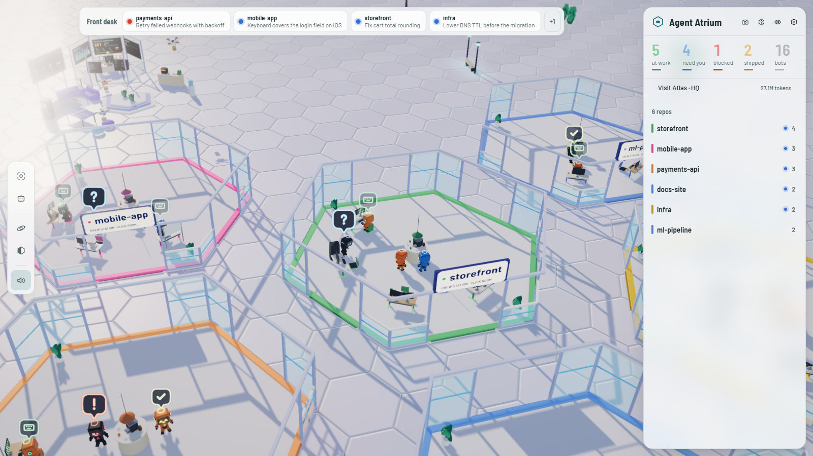
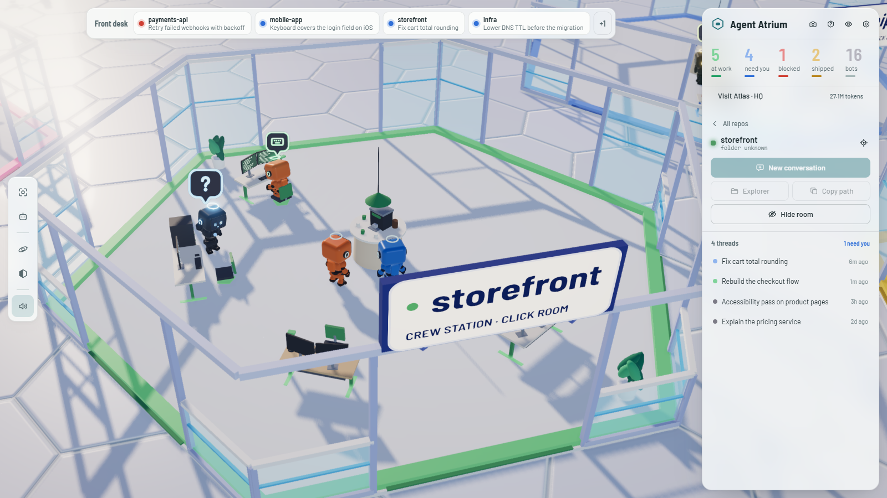
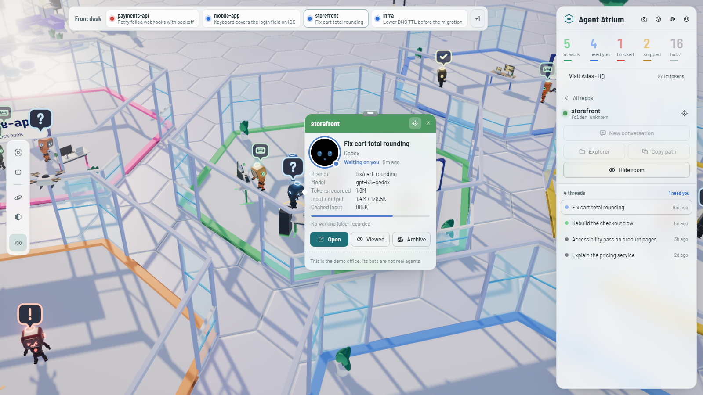
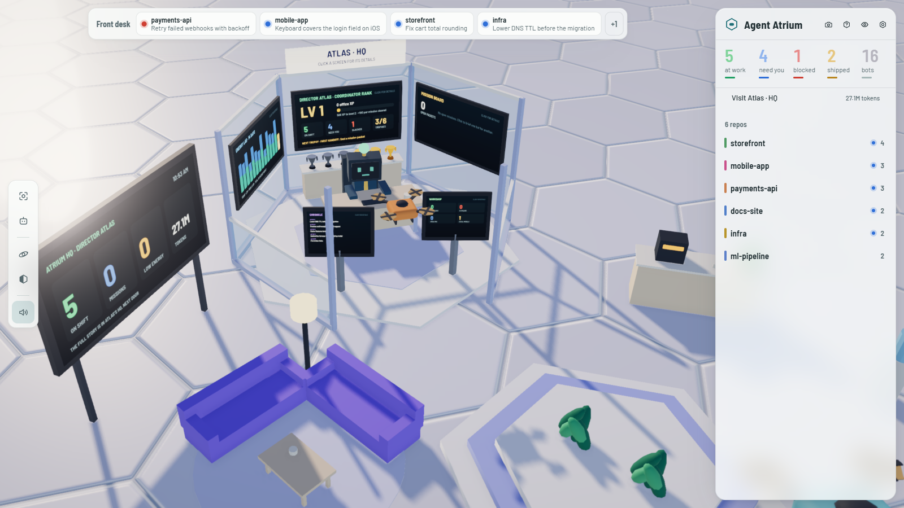
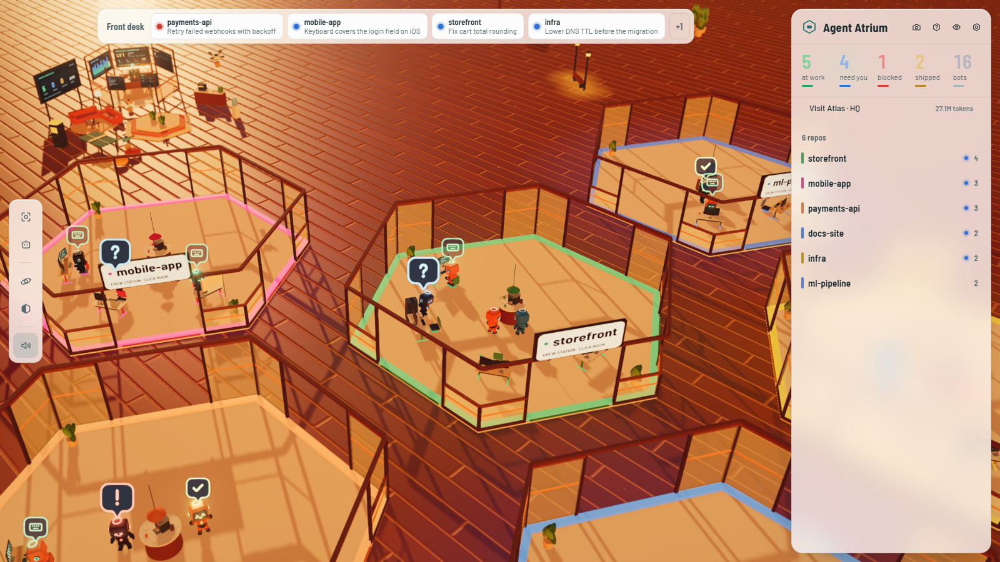
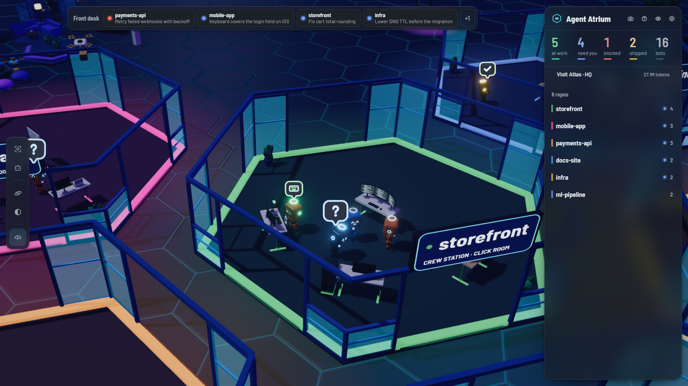

<h1 align="center">Agent Atrium</h1>

<p align="center">
  <strong>Your coding-agent threads, as bots in a glass office.</strong><br>
  A live 3D agent office and workspace for every Claude Code, Codex, VS Code, Cursor and OpenCode
  session on your machine: a multi-agent dashboard you can walk around in.
</p>

<p align="center">
  <a href="https://github.com/Venutian/agent-atrium/actions/workflows/ci.yml"></a>
  <a href="LICENSE"></a>
  
  
  
</p>

<p align="center">
  
</p>

<table>
  <tr>
    <td width="33%"></td>
    <td width="33%"></td>
    <td width="33%"></td>
  </tr>
  <tr>
    <td align="center"><sub>Working bots sit at their desks; idle ones take a coffee break</sub></td>
    <td align="center"><sub>Click a bot for its staff badge</sub></td>
    <td align="center"><sub>Director Atlas's HQ: the stats live on its walls</sub></td>
  </tr>
</table>

<table>
  <tr>
    <td width="50%"></td>
    <td width="50%"></td>
  </tr>
  <tr>
    <td align="center"><sub>Sunset Loft</sub></td>
    <td align="center"><sub>Neon Night</sub></td>
  </tr>
</table>

<p align="center"><sub>Screenshots are of the built-in demo office (<code>npm run demo</code>), not anyone's real work.</sub></p>

Every thread on this machine — Claude Code, Codex, VS Code chat and more — is a small bot.
Each repo gets its own glass room on an open office floor, with a desk for every thread. New
bots arrive at reception, walk to their desks and get to work; the screens show what each one
is doing. A bot that needs you stops and holds a `?` over its head and joins the front desk at
the top of the screen. Click it for its staff badge: open the thread back in the app it came
from, or message the bot right there and its reply comes back to the badge.

The scanner reads the agents' own files on your machine and uploads nothing. Agent Atrium
has no account and never edits those files itself. Your layout is saved in `data/atrium.json`.
A message you send a bot goes through that agent's own CLI and configured model provider;
the CLI records the turn in its session and uses your existing account and permissions.

## Try the demo

No agents installed, or just curious? The demo office fills the floor with made-up threads in
made-up repos:

```bash
git clone https://github.com/Venutian/agent-atrium.git
cd agent-atrium
npm install
npm run demo     # then open http://localhost:5275
```

The demo keeps its own layout in `data/demo/` and never reads your agents' files. Its bots
cannot be opened or messaged.

## Run it

Needs [Node 22.13 or newer](https://nodejs.org).

**Windows, no command prompt afterwards.** Once, in the project folder:

```powershell
npm install
powershell -NoProfile -ExecutionPolicy Bypass -File tools\install-windows.ps1
```

That puts **Agent Atrium** on your Desktop and in the Start menu, and starts it in the
background when you log in. Add `-NoStartup` to skip the login entry, or `-Remove` to take
every shortcut away again.

The shortcut starts the server hidden if it is not already running, then opens the page. After
a `git pull` it rebuilds and restarts only what changed, so the next click picks up new code.
Logs and errors are in `data/`.

**Ubuntu and other Linux desktops.** Once, in the project folder:

```bash
npm ci
node tools/install-linux.mjs     # --no-startup, --no-desktop, --no-dock to skip; --remove to undo
```

That adds **Agent Atrium** to the application menu, the Desktop and the dock favourites, and
starts it in the background when you log in. Run it with the Node you want the shortcuts to use
(with nvm, `nvm use 24` first). `tools/launch.sh` is the launcher it uses: it rebuilds what changed, starts the server
for this checkout only, and opens the page. `tools/launch.sh --stop` stops it.

**Any platform, from a terminal:**

```bash
npm install
npm start        # build, then serve on http://localhost:5274
npm run dev      # or the live-reloading dev server
npm test
```

It answers only on `127.0.0.1` by default. Set `AGENT_ATRIUM_HOST=0.0.0.0` to reach it from
another device on your network.

## Office styles

Pick one in **Settings → Office style**, or press `Tab` to step through them. Each is its own
colour story: a gradient sky the floor fades into, a floor with real relief (bevelled tiles,
planks, stone or carpet, each with its own normal map), soft shadows from a tinted key light,
a rim light in a second colour that outlines the bots, and a touch of depth of field.

| Style | Look |
| --- | --- |
| **Glass Studio** (default) | Pearl-white glass rooms, cool reflections and long afternoon shadows |
| **Evening Office** | Late-afternoon daylight on carpet and oak, soft blue shade behind white frames |
| **Sunset Loft** | Amber evening light across dark timber floors, an orange sky behind |
| **Greenhouse** | Low sunlight through steel and glass, warm stone and deep leafy shadows |
| **Neon Night** | Low moonlight, silver-blue highlights and violet edges across a dark tiled floor |

Every style is the same office. Your rooms, bots and layout stay put when you switch.

## Director Atlas's HQ

Beside the status board in the commons sits **Atlas**, the office director, in a big glass hex
office of their own. **Visit Atlas · HQ** in the panel flies you there. The office's numbers
are on its walls, so you can read them without opening anything:

- **Rank screen:** your coordinator level and XP, who is on shift, waiting or blocked, and the
  next trophy to earn.
- **Energy screen:** recorded tokens for each of the last 14 days, with today in gold.
- **Mission screen:** open handoff packets and who they are for.
- **Workshop and Chronicle kiosks** by the door: CI passing and failing, open PRs, local models
  online, and the latest changes in the office.
- **Trophy cabinet:** six cups that light up gold as you earn them: first handoff, mission
  cleared, inbox zero, full house, shipped, and a million-token day.

Every screen lights up under the pointer, and clicking one opens its tab of the HQ panel for
the full details (click Atlas or the cabinet for the briefing). Everything in it comes from
real local data; nothing is simulated or written by a model.

- **Daily briefing:** who is on shift, who needs a decision and who is ready for review, with a
  button to fly to each one.
- **Energy lab:** recorded tokens per day for the last 14 days (UTC), by model, plus an optional
  daily token budget and an alert when a provider's reported allowance runs low.
- **Mission board:** search every bot by task, repo, model, branch or status, and write a
  handoff from one agent to another. A mission is a sealed briefing you review, then deliver to
  the receiving agent's app yourself. No model is ever run for you. Completing a mission earns
  office XP.
- **Chronicle:** what changed and when: arrivals, status changes, missions, merged PRs and
  failed builds. It keeps the last 500 events.
- **Workshop:** a read-only health check per repo: branch, uncommitted changes, the pull request
  and its CI checks through your own `gh` login, and the local model servers it can see (Ollama,
  LM Studio) with NVIDIA GPU memory. The same reading shows on each room's sign.

Local test results are never run for you. To show them, have your test script write
`.agent-atrium/health.json` in the repo:

```json
{ "tests": "passed", "updatedAt": 1760262000000 }
```

`tests` is `passed`, `failed` or `running`. A report older than a day is marked as old.

## Office stats

The **Energy lab** in Atlas's HQ shows recorded tokens by assistant, model and repository. Bot
badges also show input/output, cached input and context headroom when reported.
The view includes scanned hidden and archived sessions; it excludes helper/subagent logs and
cloud-only work. Totals are local session records, not a billing statement. Forked sessions may
repeat inherited history, and providers may omit some usage.

- **Claude Code:** assistant-message usage, deduplicated by message ID; input includes cache
  reads and writes. The local logs do not expose a dependable remaining subscription allowance.
- **Codex:** cumulative token snapshots, model changes and last-call context capacity; remaining
  allowance windows and reset times are shown when recorded. These limits may be shared across
  models. Old reports are marked, and expired windows stay unknown until a new report arrives.
- **VS Code Chat:** provider-reported whole-turn model totals where available. Older records
  contain latest-call input and accumulated output, which are labelled partial. Missing usage,
  including local models that do not report it, stays unknown. Copilot credits used are shown
  on a badge when recorded; they are not a remaining account balance.

Usage is read locally without making provider requests or reading authentication credentials.
Unchanged logs are cached; appended records are read incrementally. Provider-usage links let
you check the authoritative account view yourself.

## Reading the office

- **A room per repo.** A busy repo grows into a bigger room, with its parts joined by floor. The
  sign on its wall is the repo's name.
- **A desk per thread.** Each thread gets its own workstation and chair, picked from its id: a
  focus desk, dual or triple screens, a laptop rig, a desk with a build server, or a planning
  desk with a whiteboard. A working bot sits in its chair and types; one waiting on you, stuck
  or celebrating stands just behind it.
- **A coffee corner per room.** An island with an espresso machine under a lamp in the room's
  colour. Idle bots leave their desks for a coffee break there, and walk back when their thread
  starts working again. The screens scroll code in the bot's status colour: busy green while it works, slow
  blue while it waits on you, a stalled red on an error, gold when its work shipped.
- **The bots.** Each has a monitor for a head, its face on an LED screen behind glass, with a
  halo floating above it and light rings round its ears, both in its status colour, so you
  can read the whole floor from straight above. Below it is a chunky, toy-like hard-shell body:
  a round chest with a status lamp, a jointed waist, ball joints, gauntlets, big mitts and boots. Shell
  colour is the agent: Claude Code bots are orange, Codex bots are black, and everything else
  is blue.
- **Badges are the status.** `?` waiting on you, `!` hit an error, a keyboard means typing at
  its desk right now, `✓` its pull request landed. A bot with no badge is idle, on its coffee
  break. One that has been
  quiet for three days dozes off by its desk, and so does one whose error is days old.
- **The commons** around reception has a lounge, a coffee bar, a water cooler, a ping-pong table,
  an arcade cabinet, Director Atlas's glass office, and a status board showing who is on shift,
  open missions, low allowances and today's tokens.
- **The open floor** around the rooms has potted trees with bench rings, lamp posts, plant
  clusters and the odd sculpture, with glowing specks drifting through the air.
- **Delivery drones** carry parcels from reception to the desks.
- **Quiet repos fold away.** A room where every thread has been silent for three days leaves the
  floor and comes back in the same place when one wakes up. Turn this off in
  **Settings → View → Hide dormant repos**.

The **front desk**, at the top of the screen, lists the bots waiting on you or stuck, newest
first; click one to go to it. It is not there when nobody needs you. The tab title counts them
too, such as `(2 need you · 1 blocked)`, and **Settings → Alerts** turns on desktop
notifications for new ones while the tab is in the background.

## Getting around

| | |
| --- | --- |
| **Drag** | Grab the floor and move it |
| **Right-drag** (or ⌃ / ⇧ / middle-drag) | Tilt and turn |
| **Scroll** | Zoom toward whatever is under the cursor |
| **Two fingers** | Pinch to zoom, drag to move |
| **Arrows**, **+** / **−** | Move and zoom from the keyboard |

The view opens on the whole office, centred in the space beside the panels.
**Reset view** (`0`) comes back to it.

## Clicking a bot

Its **staff badge** opens next to it: the repo across the top in its room's colour, the thread
as its name, the agent as its role, its status as a presence light, and its branch, model and
working folder. The camera follows the bot until you put the badge away; the crosshair on the
badge turns following off.

- **Open** (`Enter`) takes you back to the thread where it lives and brings that window to the
  front. A session you ran in VS Code opens in VS Code, in the window that has its folder; a
  desktop-app session opens in the Claude or Codex app. On Linux, bringing the window forward uses
  `wmctrl` or `xdotool` when one is installed (X11). *Settings → View → Open threads in:
  Terminal* resumes it with the agent's own CLI instead.
- **Viewed** (`V`) puts its hand down until it does something new.
- **Archive** (`A`) sends the bot back to reception. Nothing is changed in the agent's own records.

### Messaging a bot

Under the buttons is a message box (`R` puts the cursor in it). Type an instruction, or start
from **Continue**, **Where are you at?** or **Run the tests**, and press `Enter`. The line
under the box says where it will go before you send:

- **In the background**, when the agent's CLI is installed (`claude` for Claude Code, `codex`
  for Codex). The CLI runs one turn of that same session in its folder, the bot works at its
  desk while it does, and the reply lands on the badge with a toast. One message at a time per
  bot. With **Can edit files** off, Claude uses Plan mode and Codex uses a read-only sandbox.
  Enable it to continue implementation: Claude uses `acceptEdits` with your CLI's configured
  permissions, and Codex uses `workspace-write` with approvals disabled. Read-only Claude
  replies inspect files; enable edits or use the app to run commands such as tests.
- **In the app**, when there is no CLI, the thread is mid-turn, or you click **Type it in the app
  instead**. A Claude Code session in VS Code opens with your message already typed in its
  input; anywhere else the thread opens and your message is on the clipboard to paste.

Click a room's floor or its sign for the repo: start a **new conversation** there (`C`), open
the folder, copy its path, or hide the room. Hidden rooms are listed at the foot of the panel.

Hold the mouse on a room's floor for a moment to pick it up, and drop it somewhere else on the
grid. The layout is remembered.

## Keys

| Key | Does |
| --- | --- |
| `H` / `Ctrl \` | Hide every panel |
| `S` | Settings |
| `N` | Fly to the next bot waiting on you |
| `Enter` / `A` / `V` | Open / archive / mark viewed |
| `R` | Message the selected bot |
| `C` | New conversation in the open room's repo |
| `O` | Orbit mode, a slow sweep around the office |
| `Tab` | Next office style |
| `M` | Mute |
| `P` | Screenshot |
| `0` | Reset the view |
| `Esc` | Deselect, then close the room |
| `?` | Help |

## Which agents it reads

| Agent | Notes |
| --- | --- |
| **Claude Code** | Desktop app, CLI and the VS Code extension, including worktrees. Running subagents join their parent as bots |
| **Codex** | Desktop app, CLI and the VS Code extension. Running subagents join their parent as bots; review threads are left out |
| **VS Code chat** | The built-in chat, including custom and local models |
| **Cursor** | Agent transcripts |
| **OpenCode** | Top-level sessions |
| **Antigravity CLI** | Transcripts |
| **Hermes** | Sessions per profile |
| **Kilo Code** | Top-level sessions |
| **Your own agents** | Any agent that writes a small JSON status file. See [docs/custom-agents.md](docs/custom-agents.md) |

Every agent that is installed shows up at once. To add a new one in code, see
[server/harnesses/README.md](server/harnesses/README.md).

## Settings worth knowing

- **Quality preset**, from *Potato* to *Ultra*. *Adaptive quality* lowers the resolution by
  itself if frames get slow.
- **Max bots** caps how many are drawn. The ones that need you are always kept.
- **Delivery drones**: off, some or full.
- **Sound**: a working office, made live in the browser with no audio files: ventilation,
  people talking somewhere across the floor, the odd mug, chair or printer, typing where bots
  are working, drones going past, and a soft glass bell when a bot starts waiting on you. After
  dark the talk thins out. It is on, but silent until your first click, as browsers require.
  To use your own recordings, see [public/audio/README.md](public/audio/README.md).

## Credits and licence

Agent Atrium is a fork of [Bot Crossing](https://github.com/Station-Sciences/bot-crossing) by
**Jarren Rocks**, used under the MIT licence. It is not affiliated with or endorsed by that
project. The office, its desks, commons and styles, the interface and its icons, the status
badges, the sound, messaging, Atlas's HQ and the bots' design, head and body, are this
project's own.

The code is [MIT](LICENSE). The bots' skeleton and animations in `public/assets/` come from
**[Kay Lousberg](https://kaylousberg.com)**'s CC0
[Character Animations](https://kaylousberg.itch.io/kaykit-character-animations) pack. The
interface type is Barlow and Barlow Semi Condensed by Jeremy Tribby, under the
[SIL Open Font License](public/fonts/OFL.txt). See [CREDITS.md](public/assets/CREDITS.md).

## Contributing

Issues and pull requests are welcome. `npm test` runs the suite, and `npm run demo` gives you an
office to try changes against. To teach the office a new agent, start with
[server/harnesses/README.md](server/harnesses/README.md). If you like it, a star helps other
people find it.

Not affiliated with Anthropic, OpenAI, Microsoft, Google or any other agent vendor.
